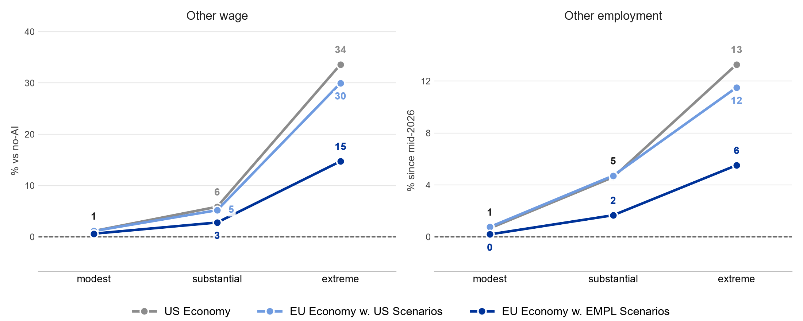

## Introduction

- Wide ranging views on how AI will impact the labor market
  - from limited effects on wages, productivity, and employment
  - to a large-scale transformation
- Antropic built a model that turns a few assumptions into measurable outcomes
  - in particular: paths for GDP / wages / unemployment by 2030
- We change their model in two ways:
  - set the parameters to reflect our labor market
  - adjust the assumptions on what AI can *already* and *will be able to* do
    - disclaimer: scenarios to explore and not forecasts

## Model {.section}

## What the model does

{fig-align="center" width="100%"}

## Scenarios {.section}

## What Scenarios Set for 2030

+----------------------+--------------------------------------------------------------+
| **Use of AI**        |                                                              |
+----------------------+--------------------------------------------------------------+
| Capability           | share of work AI can do (replacing or assisting)             |
+----------------------+--------------------------------------------------------------+
| Adoption             | share of that actually done with AI                          |
+----------------------+--------------------------------------------------------------+
| **Effect on tasks**  |                                                              |
+----------------------+--------------------------------------------------------------+
| Automation           | share where AI replaces workers                              |
+----------------------+--------------------------------------------------------------+
| New tasks            | share of displaced work returning as new tasks               |
+----------------------+--------------------------------------------------------------+
| Gain per task        | how much faster AI does a task                               |
+----------------------+--------------------------------------------------------------+
| **Finding new jobs** |                                                              |
+----------------------+--------------------------------------------------------------+
| Switching            | how easily displaced workers get hired in other jobs         |
+----------------------+--------------------------------------------------------------+
| Hiring speed         | how quickly firms post vacancies for the workers they want   |
+----------------------+--------------------------------------------------------------+
| **Today**            | *same in all scenarios*                                      |
+----------------------+--------------------------------------------------------------+
| Capability           | AI can do 14% of all work (EU: 12%)                          |
+----------------------+--------------------------------------------------------------+
| Adoption             | of that work, 10% is actually done with AI (EU: 6%)          |
+----------------------+--------------------------------------------------------------+

## Scenario Assumptions

| | US | EU | why |
|----------------------------------|------------------------------------------|-----------------------------------|-----------------------------------------------------------------------------------------|
| **Use of AI** | | | |
| Capability | 20 / 30 / 50% | [18 / 28 / 48%]{.lower} | occupation mix |
| Adoption | 20 / 40 / 60% | [12 / 24 / 36%]{.lower} | lower start carried forward |
| **Effect on tasks** | | | |
| Automation | 50 / 75 / 90% | [25 / 50 / 75%]{.lower} | data counts iterations as automation |
| New tasks | 50 / 25 / 0% | [75 / 50 / 25%]{.higher} | historically: more new tasks |
| Gain per task | 35 / 42 / 57% | same | property of the tool |
| **Finding new jobs** | | | |
| Switching | 3 / 6 / 13 months | same | no differences in retraining time |
| Hiring speed | 7 / 2.5 / 1 months | same | no data to estimate |

## The European economy

| | US | EU |
|---|---|---|
| unemployment | 3.8% | [4.6%]{.higher} |
| monthly job-finding rate | 22% | [10%]{.lower} |
| annual quits | 11% | [6%]{.lower} |
| wage stickiness | 0.5 | [0.7]{.higher} |

## Results {.section}
Labour Market in 2030 (relative to no-AI)

## Comparing Results

| | | |
|----------------------------------------------------------|------------------------------------------------------------|------------------------------------------|
| **Three sets of results** | **Economy** | **Scenarios** |
| [US Economy]{.grey} | US | Korinek Paper |
| [EU Economy w. US Scenarios]{.lightblue} | EU | Korinek Paper |
| [EU Economy w. EMPL Scenarios]{.blue} | EU | EMPL |
| **What if** | | |
| [EU Economy w. US Adoption]{.blue} | EU | EMPL but US adoption |
| **Outcomes in 2030 (vs. no AI)** | | |
| Overall | GDP, unemployment, labour share | |
| Cognitive workers | wage, employment | |

## GDP

{fig-align="center" width="100%"}

## Unemployment

{fig-align="center" width="100%"}

## Labour share

{fig-align="center" width="100%"}

## Cognitive wage

{fig-align="center" width="100%"}

## Cognitive employment

{fig-align="center" width="100%"}

## What if Europe caught up on adoption?

{fig-align="center" width="100%"}

## Takeaways {.tight}

| | | | | |
|-------------------------------|------------|--------------|--------------|-----------------------------|
| **Each set vs the one above** | **GDP** | **Unemployment** | **Cognitive wages** | **Why** |
| [US Economy]{.grey} | | | | |
| [EU Economy w. US Scenarios]{.lightblue} | similar | higher | fall less | stickier wages, slower hiring |
| [EU Economy w. EMPL Scenarios]{.blue} | lower | lower | rise | lower adoption, less automation |
| [EU Economy w. US Adoption]{.blue} | higher, < US | higher, ≈ US | rise more | faster adoption |
| [ongoing work: why adoption differs]{.footnote} | | | | |

## Comparison with the JRC's EDGE simulation

| | Our scenarios | JRC EDGE-EUROMOD |
|----------------------------------|-----------------------------------------------------------------------------------|-----------------------------------------------------------------------------------|
| **Similar** | | |
| Scenarios | modest / substantial / high impact by 2030 | low / medium / high impact by 2035 |
| **Different** | | |
| Assumptions | what AI can do + how much it is used | *outcomes* like TFP, wages, unemployment |
| Results | GDP + labour market impact | distributional effects of given shock |
| Dynamics | better AI → more use → jobs adjust | same AI → 3.6×\* use → 3.6× effects |
| Mechanisms | sticky wages, job search, switching / re-education | none: effects imposed, not explained |
| Coverage | EU aggregate, two occupation groups | DE, ES, PL, SE; age and gender |
| | | [\* growth to full AI use in most exposed jobs]{.footnote} |

## Thank you {.end}

**© European Union 2026**

Unless otherwise noted the reuse of this presentation is authorised under the [CC BY 4.0](https://creativecommons.org/licenses/by/4.0/) license. For any use or reproduction of elements that are not owned by the EU, permission may need to be sought directly from the respective right holders.

## Appendix {.section}

## Why adoption starts lower in Europe {.dense}

| | US | EU | EU / US |
|----------------------------------------------------------------|------------|------------|------------|
| **People, any purpose, 2025** | | | |
| monthly LLM users, millions, total (A) | 61 | [133]{.higher} | 2.2 |
| **Workers, 2026** | | | |
| use genAI for work (B) | 43% | [30%]{.lower} | 0.69 |
| share of work hours with genAI (B) | 5.2% | [1.7%]{.lower} | 0.33 |
| **Firms, 2025** | | | |
| use AI, any purpose (C) | 34% | [20%]{.lower} | 0.59 |
| deploy genAI (D) | 36% | [37%]{.higher} | 1.03 |
| of AI users: in more than two activities (D) | 81% | [55%]{.lower} | 0.68 |
| **Our model, today** | | | |
| share of AI-doable work done with AI (E) | 10% | [6%]{.lower} | 0.6 |
| [(A) Prosus/Dealroom, Europe (B) Bick et al. 2026, EU-5 (C) Eurostat; US Census (D) EIB survey (E) AIM-WORK; Korinek et al.]{.footnote} | | | |

## Other workers gain in every scenario

{fig-align="center" width="100%"}
