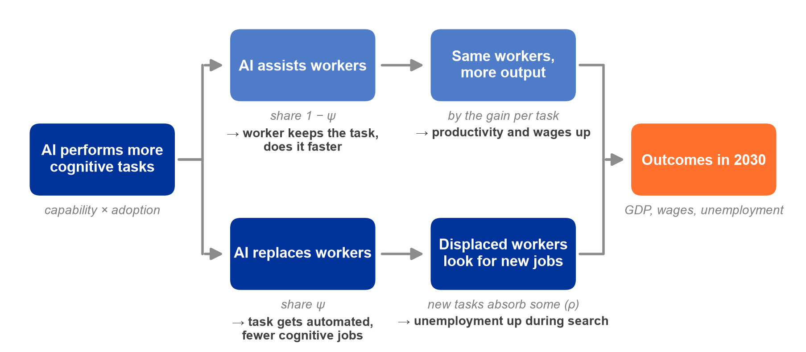
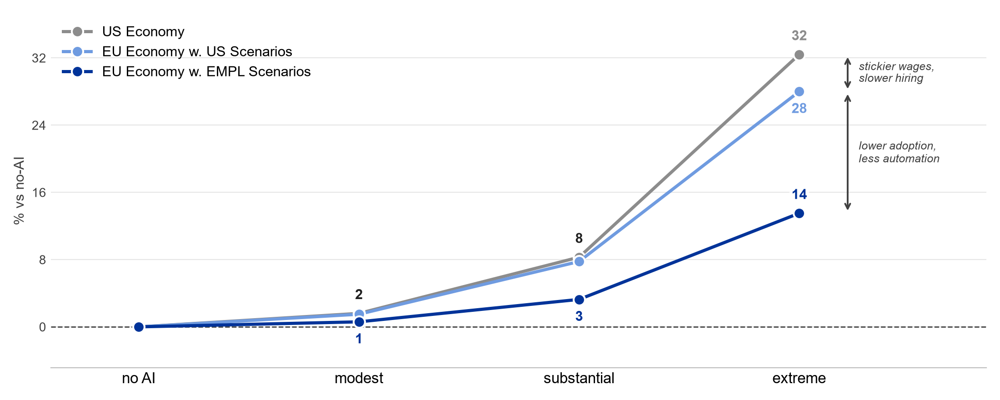
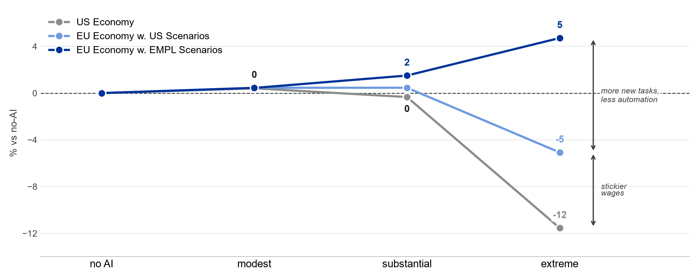
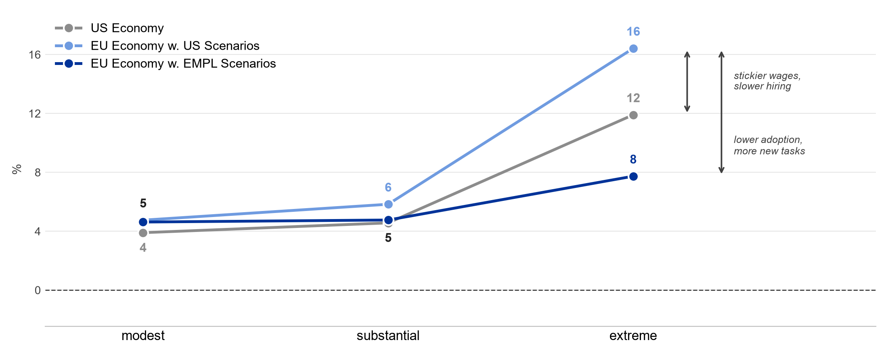
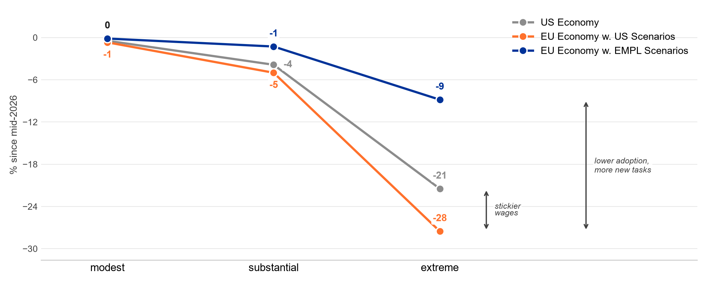
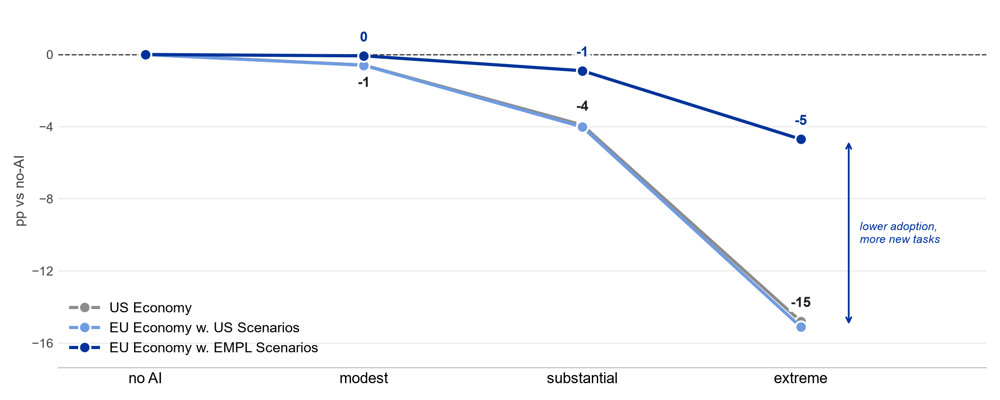
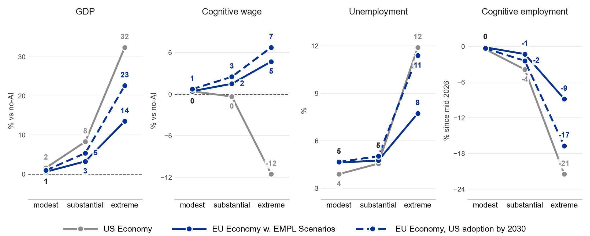

## Introduction

- Wide ranging views on how AI will impact the labor market
  - from limited effects on wages, productivity, and employment
  - to a large-scale transformation
- Antropic built a model that turns a few assumptions into measurable outcomes
  - in particular: paths for GDP / wages / unemployment by 2030
- We change their model in two ways:
  - set the parameters to reflect our labor market
  - adjust the assumptions on what AI can *already* and *will be able to* do
    - disclaimer: scenarios to explore and not forecasts

## Model {.section}

## What the model does

{fig-align="center" width="100%"}

## Scenarios {.section}

## What Scenarios Set for 2030

+----------------------+--------------------------------------------------------------+
| **Use of AI**        |                                                              |
+----------------------+--------------------------------------------------------------+
| Capability           | share of work AI can do (replacing or assisting)             |
+----------------------+--------------------------------------------------------------+
| Adoption             | share of that actually done with AI                          |
+----------------------+--------------------------------------------------------------+
| **Effect on tasks**  |                                                              |
+----------------------+--------------------------------------------------------------+
| Automation           | share where AI replaces workers                              |
+----------------------+--------------------------------------------------------------+
| New tasks            | share of displaced work returning as new tasks               |
+----------------------+--------------------------------------------------------------+
| Gain per task        | how much faster AI does a task                               |
+----------------------+--------------------------------------------------------------+
| **Finding new jobs** |                                                              |
+----------------------+--------------------------------------------------------------+
| Switching            | how easily displaced workers get hired in other jobs         |
+----------------------+--------------------------------------------------------------+
| Hiring speed         | how quickly firms post vacancies for the workers they want   |
+----------------------+--------------------------------------------------------------+
| **Today**            | *same in all scenarios*                                      |
+----------------------+--------------------------------------------------------------+
| Capability           | AI can do 14% of all work (EU: 12%)                          |
+----------------------+--------------------------------------------------------------+
| Adoption             | of that work, 10% is actually done with AI (EU: 6%)          |
+----------------------+--------------------------------------------------------------+

## Scenario Assumptions

| | US | EU | why |
|----------------------------------|------------------------------------------|-----------------------------------|-----------------------------------------------------------------------------------------|
| **Use of AI** | | | |
| Capability | 20 / 30 / 50% | [18 / 28 / 48%]{.lower} | occupation mix |
| Adoption | 20 / 40 / 60% | [12 / 24 / 36%]{.lower} | lower start carried forward |
| **Effect on tasks** | | | |
| Automation | 50 / 75 / 90% | [25 / 50 / 75%]{.lower} | data counts iterations as automation |
| New tasks | 50 / 25 / 0% | [75 / 50 / 25%]{.higher} | historically: more new tasks |
| Gain per task | 35 / 42 / 57% | same | property of the tool |
| **Finding new jobs** | | | |
| Switching | 3 / 6 / 13 months | same | no differences in retraining time |
| Hiring speed | 7 / 2.5 / 1 months | same | no data to estimate |

## The European economy

| | US | EU |
|---|---|---|
| unemployment | 3.8% | [4.6%]{.higher} |
| monthly job-finding rate | 22% | [10%]{.lower} |
| annual quits | 11% | [6%]{.lower} |
| wage stickiness | 0.5 | [0.7]{.higher} |

## Results {.section}
Labour Market in 2030 (relative to no-AI)

## Comparing Results

- **US Economy**: the paper as published
- [EU Economy w. US Scenarios]{.orange}: European labour market w. US Scenarios
- [EU Economy w. EMPL Scenarios]{.blue}: European labour market w. our scenarios

## GDP

{fig-align="center" width="100%"}

## Cognitive wage

{fig-align="center" width="100%"}

## Unemployment

{fig-align="center" width="100%"}

## Cognitive employment

{fig-align="center" width="100%"}

## Labour share

{fig-align="center" width="100%"}

## What if Europe caught up on adoption?

{fig-align="center" width="100%"}

## Takeaways

- Same scenarios in European labour market: **similar gains, more unemployment**
  - stickier wages + slower hiring turn wage cuts into job losses
- Different European scenarios: **smaller gains, smaller disruption**
  - more new tasks and less automation protect cognitive workers
  - most of the gap is adoption: Europe starts lower and does not catch up
- Adoption as an important lever
  - catching up with US adoption by 2030: gains up by two thirds, cognitive wages still rise
  - but in the extreme scenario unemployment then approaches the US level
  - ongoing work on why adoption differs so much across countries
- These parameters are uncertain and open for debate
  - automation share, new tasks and the adoption path are judgement calls

## Comparison with the JRC's EDGE simulation

| | Our scenarios | JRC EDGE-EUROMOD |
|----------------------------------|-----------------------------------------------------------------------------------|-----------------------------------------------------------------------------------|
| **Similar** | | |
| Scenarios | modest / substantial / high impact by 2030 | low / medium / high impact by 2035 |
| **Different** | | |
| Assumptions | what AI can do + how much it is used | *outcomes* like TFP, wages, unemployment |
| Results | GDP + labour market impact | distributional effects of given shock |
| Dynamics | better AI → more use → jobs adjust | same AI → 3.6×\* use → 3.6× effects |
| Labour market | job search, switching, sticky wages | none: effects imposed directly |
| Coverage | EU aggregate, two occupation groups | DE, ES, PL, SE; age and gender |
| | | [\* growth in AI use that takes the most exposed occupations to full adoption]{.footnote} |

## Thank you {.end}

**© European Union 2026**

Unless otherwise noted the reuse of this presentation is authorised under the [CC BY 4.0](https://creativecommons.org/licenses/by/4.0/) license. For any use or reproduction of elements that are not owned by the EU, permission may need to be sought directly from the respective right holders.
